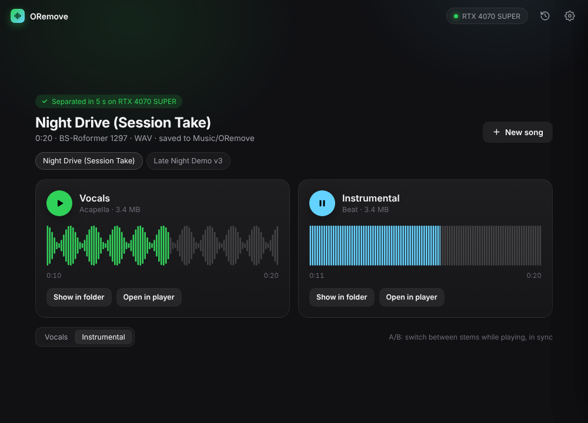

<h1 align="center">ORemove</h1>
<h3 align="center">AI Powered Vocal Isolator</h3>

<p align="center">
  Clean acapellas and instrumentals from any YouTube link or audio file, powered by state-of-the-art Roformer models.
</p>

<p align="center">
  <a href="https://github.com/crawfordj0611-lang/ORemove-Vocal-Isolator-/releases/latest"></a>
  
  
  
</p>

<p align="center">
  
</p>

## Features

- **Drag, drop, done.** Audio files (MP3, WAV, FLAC, M4A and more), video files, or a YouTube link; one song or a whole batch.
- **Top-rated models.** BS-Roformer and MelBand Roformer for the cleanest results, plus a fast MDX-Net option.
- **GPU accelerated.** NVIDIA GPUs on Windows and Apple Silicon on Mac, with 16-bit processing for extra speed.
- **Listen instantly.** Waveforms, in-app playback, A/B switching between vocals and instrumental, and drag-and-drop of stems straight into your DAW (Windows).
- **Lossless and private.** WAV or 320 kbps MP3 output; everything runs on your computer.

## Download

**[Get the latest release](https://github.com/crawfordj0611-lang/ORemove-Vocal-Isolator-/releases/latest)**, then follow the **[installation guide](INSTALL.md)**.

| Edition | For | Download |
|---|---|---|
| **Windows · NVIDIA GPU** | PCs with an NVIDIA GeForce GTX 900-series or newer | `ORemove-NVIDIA-GPU-Setup.exe` |
| **Windows · CPU** | Any 64-bit Windows PC, including AMD and Intel graphics | `ORemove-Windows-CPU.zip` |
| **macOS** | Apple Silicon (M1 or newer), macOS 13+ | `ORemove-macOS-AppleSilicon.dmg` |

On Windows, GPU acceleration works with **NVIDIA graphics cards only**. On other PCs, use the CPU edition: it works everywhere, but is much slower.

> [!NOTE]
> **NVIDIA GPU edition: just download `ORemove-NVIDIA-GPU-Setup.exe` and run it.** Setup downloads the rest of ORemove (about 1.9 GB) and checks it as it installs. The `.bin` and `parts.txt` files on the release page are what it downloads, so you can ignore them.

> [!CAUTION]
> **ORemove is free.** If anyone charged you for it, you've been scammed. Only download it from the [official releases page](https://github.com/crawfordj0611-lang/ORemove-Vocal-Isolator-/releases).

## Models

| Model | Best for | Size |
|---|---|---|
| **BS-Roformer 1297** (default) | Instrumentals: highest-rated in audio-separator's benchmark | 610 MB |
| **BS-Roformer 1296** | Acapellas: highest-rated in the same benchmark | 610 MB |
| **MelBand Roformer Inst** (becruily) | The fullest instrumentals | 871 MB |
| **MelBand Roformer Vocals** (becruily) | The fullest acapellas | 871 MB |
| **MDX-Net Inst HQ 3** | Speed | Included |

Models download once, on first use. **Quality: Faster** roughly halves Roformer processing time for a small quality trade-off.

## Requirements

| | Windows · NVIDIA GPU | Windows · CPU | macOS |
|---|---|---|---|
| **Hardware** | NVIDIA GPU, 8 GB VRAM recommended (4 GB minimum) | 6–8 core CPU recommended | Apple M1 or newer |
| **Memory** | 16 GB | 8 GB minimum, 16 GB recommended | 8 GB minimum, 16 GB recommended |
| **Disk** | ~6 GB + up to 3 GB of models | ~2 GB + up to 3 GB of models | ~2 GB + up to 3 GB of models |

Stems are saved to **Music/ORemove**. ORemove tells you when a new version is available. For help, see [installation problems](INSTALL.md#9-installation-problems).

## YouTube links

YouTube downloads use [yt-dlp](https://github.com/yt-dlp/yt-dlp), which needs updating whenever YouTube changes its site. ORemove checks for yt-dlp updates daily and installs them automatically (see **Settings → YouTube downloader**), and sets up [Deno](https://deno.com), the JavaScript runtime YouTube now requires, the first time you use a link (a one-time 40 MB download). Your own audio files are never affected.

## Running from source

Requires Python 3.10+ and FFmpeg. For an NVIDIA GPU, first install the CUDA build of PyTorch (`pip install torch torchvision --index-url https://download.pytorch.org/whl/cu126`).

```bash
pip install -r requirements.txt
```

```bash
python app.py
```

ORemove is a Python engine ([`app.py`](app.py)) built on [audio-separator](https://github.com/nomadkaraoke/python-audio-separator) and [yt-dlp](https://github.com/yt-dlp/yt-dlp), with a web interface ([`ui/`](ui)) in a native window via [pywebview](https://pywebview.flowrl.com). The [build workflow](.github/workflows/build.yml) packages and tests all three editions on GitHub Actions.

## Feedback

Like ORemove, or have an idea to make it better? Message me on Instagram: **[@newmoney_uk](https://www.instagram.com/newmoney_uk/)**.

## License

ORemove is licensed under [PolyForm Shield 1.0.0](LICENSE), with an added permission to share it for free:

- **You can** use it for anything, including paid music work, change it, and give it away for free (on its own or bundled with other free software).
- **You can't** sell it (or a changed version), charge for access to it, or bundle it with anything paid.

Separation is powered by [audio-separator](https://github.com/nomadkaraoke/python-audio-separator) and the models of the [Ultimate Vocal Remover](https://github.com/Anjok07/ultimatevocalremovergui) community; these and the other bundled components (yt-dlp, PyTorch, FFmpeg, pywebview) keep their own licenses. See [third-party notices](THIRD-PARTY-NOTICES.md).

Only separate audio you own or have permission to use; downloading from YouTube may be restricted by its Terms of Service. ORemove is not affiliated with YouTube, Google, Apple or the Ultimate Vocal Remover project.
